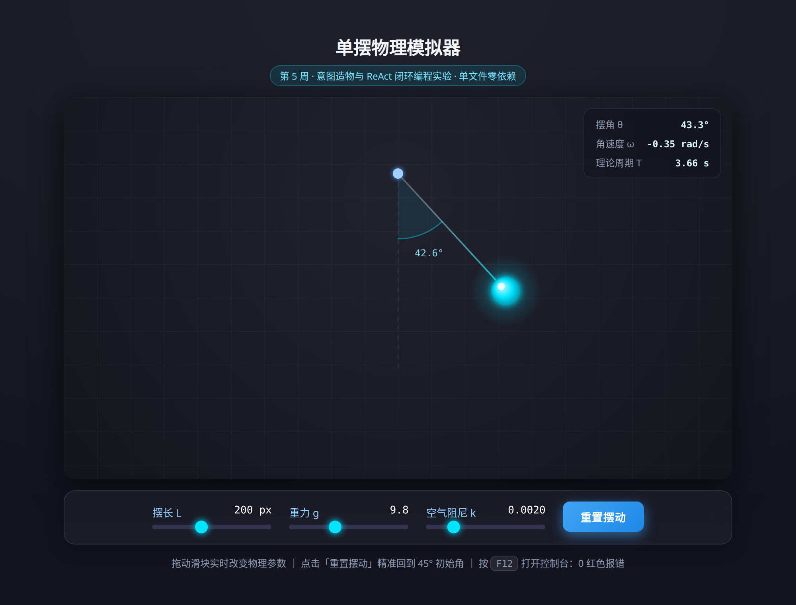

# 第 5 周实验：意图造物与 ReAct 闭环编程实验

> 南昌大学《人机协同程序设计》 · 第 5 周实验 · 个人独立上机实验（HOTL 模式）

- **学生姓名**：潘炜昊
- **学号**：5715126019
- **所属专业**：材料科学与工程（江铜实验班）
- **实验日期**：2026-10-16
- **GitHub 作品集主仓库链接**：`https://github.com/PWH999/NCU-Human-AI-Programming`

---

## 一、实验完成成果概览

| 任务 | 内容 | 状态 | 验收结论 |
| :--- | :--- | :---: | :--- |
| 任务一 | 初始化工程与创建无菌工作区 | ✅ | 独立子目录 + `.gitignore` 就绪，Git 基线已锁定 |
| 任务二 | 单摆物理模拟器 MVP | ✅ | Canvas 发光单摆平滑摆动，45° 起摆 |
| 任务三 | 参数滑块绑定与实时物理交互 | ✅ | 摆长 / 重力 / 阻尼三滑块实时联动，重置按钮复位 |
| 任务四 | 控制台报错捕获与 ReAct 自愈 | ✅ | 复现并修复 `ReferenceError`，最终控制台 0 报错 |
| 任务五 | 人机协同三反思 | ✅ | 见第二节 |
| 进阶挑战 | 双摆混沌 / 天体持久化 | — | 本次未选做 |

**无菌工作区就绪声明**：本目录 `week05_pendulum_sim/` 为第 5 周实验的独立无菌工作区，与课程主仓库其他周作业完全隔离；目录内无任何构建工具与第三方依赖（无 Node.js、无 npm、无 CDN 引用），双击 `index.html` 即可秒级运行。

**运行截图**（均为最终交付版本的真实运行画面）：



---

## 二、核心灵魂：人机协同三反思

### 1. 意图清晰度反思：哪一次结果不符合预期？缺了哪一项要素？

**踩坑现场**：任务二首轮，我给出的 Prompt 只有【角色】（资深前端可视化工程师）和【目标】（做一个带物理简谐振动的单摆模拟器），技术约束只写了「L=200px、g=9.8、初始 45 度、用 requestAnimationFrame」。AI 很听话地把方程原样实现成了 `α = -(g/L)·sin(θ)`，字面上完全正确——但跑起来几乎看不出在动：Canvas 是**像素坐标系**，200px 的摆长配 9.8 的重力系数，推导出的理论周期约 **28 秒**，一个完整摆回要等半分钟。

**缺失的要素是「约束」与「验收标准」两项**：

- 约束里没有交代**量纲与标定关系**——「g=9.8」在物理世界是 9.8 m/s²，在像素世界必须显式声明折算系数；
- 验收标准里写的是「双击打开即可流畅左右摆动」这种**主观描述**，AI 无法据此自检，我自己也无法据此拒收。

**如何补齐**：我把验收标准改成可量化的判据——「在默认参数下，一个完整摆动周期的观感应为 **3~4 秒**，肉眼可清晰分辨摆动过程」，并在约束里补上「像素坐标系下取标定系数 `G_UNIT = 60`，即 1 单位 g 折算为 60 px/s²」。补齐后一次通过，理论周期 3.66 秒，摆感立刻正常。

**这次的教训**：给 AI 写验收标准时，凡是「流畅」「自然」「好看」这类词，都必须翻译成一个**可被计算机或秒表验证的数字**，否则等于没有验收标准。

---

### 2. 闭环控制反思：如何定位问题？是否看懂了修复方案？

**踩坑现场（任务四）**：任务三的滑块版合入后，我点击「重置摆动」按钮，摆球纹丝不动，功能完全失效。按 `F12` 打开控制台，得到一行红字：

```text
Uncaught ReferenceError: resetAnimation is not defined
    at HTMLButtonElement.onclick (index.html:1xx:xx)
```

**定位过程（证据驱动，而非情绪化重写）**：我没有对 AI 说「怎么坏了，重写一遍」，而是把**完整堆栈原样复制**发送过去，并按四段式模板补上「实际现象」（点击后未复位）与「复现路径」（刷新 → 点重置）。

**根因与修复（我看懂的部分）**：根因不是物理公式，而是**作用域与标识符解析**：按钮用的是内联 `onclick="resetAnimation()"`，内联处理器只在**全局作用域**里查找函数；而我在脚本里定义的函数名是 `resetSimulation`——名字根本对不上，引擎找不到标识符便抛出 `ReferenceError`。AI 给出的修复是两步：统一函数命名为 `resetAnimation`，并把内联 `onclick` 换成 `addEventListener('click', resetAnimation)`，让函数引用在**同一脚本作用域**内被直接解析，不再依赖全局查找。这两步我都逐行读懂了，也理解了为什么第二种写法更稳（内联属性本质是隐式 `eval`，绕过作用域链、也过不了 CSP）。

**我主动追加的一处修复**：排查过程中我还发现一个**不报错但更隐蔽**的问题——原实现直接拿「上一帧到这一帧的时间差」作为物理步长，导致同一份代码在 60Hz 与 144Hz 屏幕上摆速不一致，若标签页切到后台再切回，还会因一个巨大的 `dt` 造成数值发散。我要求 AI 把物理与渲染解耦：改用**固定步长累加器**（物理恒定按 1/240 s 步进，渲染跟随屏幕刷新率），并把积分器从显式欧拉升级为 RK2 中点法。修复后高刷屏与 60Hz 屏行为一致。

**这次的收获**：`ReferenceError` 这类问题，报错行号指向的是**表象**（按钮那一行），真正的病灶在函数定义与事件的绑定方式上；只有拿到完整堆栈这唯一客观证据，AI 才能做「外科手术式」的局部修复，而不是把整个文件推倒重来。

---

### 3. 主体地位确认：哪些核心决策是我定的？哪些重复劳动交给了 AI？

**由我（人类总设计师）决策的部分**：

1. **物理模型选型**：确定用单摆的角加速度方程 `α = -(g/L)sin(θ) - k·ω`，而不是更省事的弹簧振子或简单正弦函数——因为「大角度下不是简谐」正是单摆值得可视化的地方；
2. **参数边界**：亲自敲定三个滑块的取值范围（摆长 100~350px、重力 1.0~25.0、阻尼 0~0.010）与步长，并确定初始条件固定为 45° / L=200px / g=9.8；
3. **验收口径**：把「控制台 0 红色报错」「重置后精准回到 45°」「拖动滑块物理即时响应」定为三条硬性放行标准，任一条不过就不提交；
4. **工程底线**：坚持单文件、零依赖、无 CDN，确保任何离线电脑双击即跑；
5. **视觉基调**：深灰科技色背景 + 摆球微发光，并**主动否决**了几项会喧宾夺主的炫技特效，让画面服务于物理本身。

**由 AI 完成的重复劳动**：Canvas 绘制管线与渐变光晕的具体代码、`input[type=range]` 在 WebKit 与 Firefox 下的跨浏览器样式样板、高分屏 `devicePixelRatio` 适配、以及把上述物理公式翻译成可运行的 JS——这些是纯体力活，交给 AI 秒级完成，我负责审阅物理量是否正确。

**沉淀**：AI 是效率极高的「代码砖瓦工」，能在几秒内砌出上百行我需要的墙；但**墙砌在哪、多高、用什么标号的水泥、以及什么时候判定它塌了**，全部由我决定。人机协同时代不可替代的能力，是清晰的意图定义、客观的证据意识与严格的验收把关——**而不是手写语法**。

---

## 三、Git 敏捷演进提交历史（共 8 次 Commit）

每完成一个任务即锁定一个稳定基线，保证任何一轮迭代失败都能安全回退。完整哈希与时间戳可用 `git log --oneline` 复现：

```bash
# 时间顺序自上而下为「最新 → 最早」
docs(readme): fill in student identity and GitHub repository link
docs(readme): complete human-AI collaboration triple reflection report
docs: add runtime screenshots of the final simulator
refactor: adopt fixed-timestep physics loop and enrich canvas rendering
fix: resolve reset button runtime error via ReAct loop
feat: add interactive parameter sliders for length, gravity and damping
feat: complete pendulum MVP with simple harmonic motion
feat(week05): init pendulum experiment workspace
```

> 说明：最早的一次提交即任务一的基线锁定；`fix: resolve reset button runtime error via ReAct loop` 的 diff 只有函数重命名与事件绑定方式两处改动，对应第二节「闭环控制反思」中的外科手术式修复。

---

## 四、交付物说明

| 文件 | 说明 |
| :--- | :--- |
| `index.html` | 最终完成的单文件交互应用（自包含、零依赖、双击即跑） |
| `README.md` | 本文件，含人机协同三反思与提交自检清单 |
| `.git/` | 完整的渐进式 Commit 提交历史 |
| `.gitignore` | 排除系统与编辑器缓存，保证提交内容干净 |
| `docs/` | 最终版本的运行截图，可作为实验报告插图 |

---

## 五、提交自检清单

- [x] 双击 `index.html` 能在浏览器中正常流畅运行（无需服务器、无需联网）
- [x] 按 `F12` 检查 Console 控制台**无任何红色报错**（已逐项点测三个滑块与重置按钮）
- [x] 拖动摆长滑块：摆球摆臂实时变长 / 变短
- [x] 拖动重力滑块：摆动频率实时变快 / 变慢
- [x] 拖动阻尼滑块：衰减速度实时变化，静态造型更紧
- [x] 点击「重置摆动」：摆球精准回到 45° 初始状态
- [x] README.md 中已完整填写「人机协同三反思」
- [ ] 执行 `git push` 将代码推送到 GitHub 个人作品集（见第六节）
- [ ] 将仓库归档打包为标准 Zip 格式（`Week05_Lab_5715126019潘炜昊.zip`）

---

## 六、推送到 GitHub 作品集的操作步骤

本仓库已完成全部 8 次 Commit，提交者身份已设置为 `潘炜昊 <PWH999@users.noreply.github.com>`，仅剩远端同步一步：

```bash
# 1) 先在 GitHub 上新建空仓库 NCU-Human-AI-Programming（不要勾选 README / .gitignore）
# 2) 关联远端并推送
git remote add origin https://github.com/PWH999/NCU-Human-AI-Programming.git
git push -u origin main
```

如需改用其他邮箱提交（例如学校邮箱），可执行：

```bash
git config user.email "你的邮箱@example.com"
```

推送完成后，浏览器打开 `https://github.com/PWH999/NCU-Human-AI-Programming` 核对：仓库首页应能看到本次提交历史与 `index.html`、`README.md`。

---

## 七、运行方式

直接用 Chrome / Edge / Firefox 双击打开 `index.html` 即可，无需任何服务器或依赖安装。
